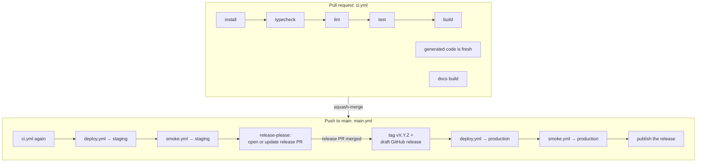

# CI/CD

**GitHub Actions does every deploy. Nobody runs a deploy command by hand.**

## The pipeline



| Workflow | Trigger | What it does |
|---|---|---|
| [`ci.yml`](https://github.com/alilibx/agentic-development-workflow/blob/main/templates/.github/workflows/ci.yml) | Every PR, and called by `main.yml` | The checks from `AGENTS.md`, one job per package; generated code is fresh; docs build |
| [`main.yml`](https://github.com/alilibx/agentic-development-workflow/blob/main/templates/.github/workflows/main.yml) | Push to `main`; break-glass dispatch | CI → staging → smoke → release-please → production → smoke → publish the release |
| [`deploy.yml`](https://github.com/alilibx/agentic-development-workflow/blob/main/templates/.github/workflows/deploy.yml) | Called by `main.yml`, or run by hand for a rollback | Deploy, migrate, seed, verify the live revision, alert. Production accepts only release tags on `main`. |
| [`smoke.yml`](https://github.com/alilibx/agentic-development-workflow/blob/main/templates/.github/workflows/smoke.yml) | After each deploy, every morning, and by hand | Loads the main pages in a headless browser |
| [`pager-test.yml`](https://github.com/alilibx/agentic-development-workflow/blob/main/templates/.github/workflows/pager-test.yml) | By hand | Sends one alert at each priority, to prove the pager works |

Release-please runs **after** staging deploys and its smoke test passes, so production only gets code that reached staging and loaded there. The GitHub release it creates stays a **draft** until production is deployed and its smoke test passes. A published release means "live and loading".

::: warning Leave out the deploy workflows until you deploy
`main.yml`, `deploy.yml` and `smoke.yml` call placeholder scripts (`./deploy/deploy.sh`, `bun run smoke`). Copied as they are, the first merge to `main` goes red and release-please never runs. Either fill them in in the adopting PR, or keep only `ci.yml` until the project deploys.
:::

## Secrets per tier {#secrets-per-tier}

Staging and production must never read each other's credentials or URLs. A production revision check that polls the staging URL passes when it shouldn't, and one token that can deploy both tiers means a staging mistake can reach production.

Whether you can use [GitHub environments](https://docs.github.com/en/actions/reference/workflows-and-actions/deployments-and-environments) for this depends on your plan:

| On a private repo | Free | Pro, Team | Enterprise |
|---|---|---|---|
| Environment secrets and variables | no | yes | yes |
| Deployment branch and tag rules | no | yes | yes |
| Required reviewers, wait timers | no | no | yes |

Public repos get all of them on every plan. GitHub has changed these rules before, so check the linked page for your plan.

The template works on every plan, and gets stronger when environments are available:

- **Secrets: suffixed repository secrets, by default.** `deploy.yml` reads `DEPLOY_TOKEN_STAGING` or `DEPLOY_TOKEN_PRODUCTION`, and `HEALTH_URL_STAGING` or `HEALTH_URL_PRODUCTION`, picking the suffix from two literal strings. A missing value fails the step; nothing falls back to the other tier. When your plan has environment secrets, you can move each one into its environment; keep the names, because an environment secret overrides the repository secret of the same name.
- **Gates: the environment, always named.** The `deploy` job sets `environment:` to the tier it deploys (`inputs.environment`), and the line stays on. Whatever rules you configure on the environment apply: deployment rules (only tags deploy to `production`), and on Enterprise or a public repo, a required reviewer on production, the approval gate that is the target. GitHub [creates a referenced environment that doesn't exist yet](https://docs.github.com/en/actions/managing-workflow-runs-and-deployments/managing-deployments/managing-environments-for-deployment), with no rules or secrets, so on a plan that can't configure environments the line is harmless.

Don't comment the `environment:` line out to "simplify" the template: that silently drops every rule configured on the environment, including the production approval. If your runs ever fail because of it, removing it is an explicit decision: record it in your project's `docs/engineering/ci-cd.md`, with the gates you lose.

Say in your project's `docs/engineering/ci-cd.md` which mode you're in. If you're on the default, say the production approval gate is deferred and why, so nobody assumes it exists.

## Rules each workflow follows

Each rule here was learned from an incident.

- **Never cancel a deploy in flight.** Set `concurrency` with `cancel-in-progress: false` on the deploy *job*. A cancelled deploy leaves the environment stale, and staging once sat stale for weeks before anyone noticed. PR CI is different: a new push cancels the PR's older run (`ci.yml` keys its group on the PR number, so it never touches the run `main.yml` calls).
- **Give every long step its own `timeout-minutes`.** A job-level timeout *cancels* the job instead of failing it.
- **Production deploys release tags only.** The deploy refuses anything that isn't `vX.Y.Z`, checks out `refs/tags/<tag>` so a branch with the same name can't stand in, and refuses a tag whose commit isn't on `main` or whose `.release-please-manifest.json` doesn't already say that version. A stray hand-pushed tag can't reach production, not even through a manual rollback.
- **Untrusted values go through `env:`.** Never write PR titles, branch names or inputs as `${{ }}` inside `run:`. Use `persist-credentials: false` when no git push follows.
- **Least privilege.** `permissions: contents: read` at the top. Only the release jobs get `contents: write` and `pull-requests: write`.
- **Secrets only where they're needed.** Pass them to the deploy steps, never to `install` (dependency install scripts run arbitrary code).
- **Pin what you run.** Pin the runtime version (`bun-version-file: package.json`), the CLIs (`vercel@<version>`, not `@latest`), and every action by commit SHA, with the tag in a trailing comment (`uses: actions/checkout@<sha> # v4.4.0`). Dependabot keeps SHA pins current.
- **Typecheck separately when the test runner strips types.** `bun test` and most bundlers don't type-check. A type error once surfaced only as a failed staging deploy.
- **Committed generated code must match a fresh run.** CI regenerates it and fails on any diff:
  ```yaml
  - run: bun run codegen
  - run: git add -A && git diff --cached --exit-code
  ```
- **A non-blocking check is a written, temporary state.** If lint (or anything else) has to start as report-only, the workflow comment and this page say why and name the issue that makes it blocking. An unexplained `|| true` becomes permanent.

## Verify what is live {#verify-what-is-live}

A green deploy step has shipped a blank page twice: once because the bundle held two copies of React, once because a stale build cache produced circular chunks. "The deploy succeeded" is not proof.

1. **The service reports its revision.** The health endpoint returns the commit it runs: `{"status":"ok","revision":"<sha>"}`. The deploy step writes the SHA in.
2. **The deploy waits for it.** The last step polls the tier's own health URL until it reports the commit just deployed, and fails otherwise.
3. **A browser smoke test** (`smoke.yml`) loads the main pages in headless Chromium after each staging and production deploy, and every morning, and fails on a blank page or console errors. In `main.yml` it runs with `if: !cancelled()`, so it still runs when a deploy leg failed, and you learn whether the site loads. A failed or skipped staging smoke stops the release; only [break-glass](/delivery/releases#break-glass), which skips staging, skips it too.

## Several deployables {#several-deployables}

When a release has a backend and one or more frontends:

- **Deploy the backend first,** so the schema and functions exist before the new frontend calls them. In the workflow, each frontend job `needs:` the backend job.
- **Keep backend changes compatible with the frontend that is live,** for the minutes between the two deploys, and for a rollback.
- **Roll back in reverse order:** the frontend first, then the backend.
- **Build once, promote.** Promoting the exact artifact that ran on staging is safer than rebuilding from the tag at release time. If you rebuild, say so.

## Alerts {#alerts}

Send deploy results to a phone, with a priority ladder. The template's [`notify` action](https://github.com/alilibx/agentic-development-workflow/blob/main/templates/.github/actions/notify/action.yml) uses [ntfy](https://ntfy.sh); swap the provider and keep the rules.

| Event | Priority |
|---|---|
| Staging deployed | low (a heartbeat: silence becomes a signal) |
| Staging failed or cancelled | high |
| Production deployed | default |
| Production failed or cancelled | urgent (gets through Do Not Disturb) |
| Smoke test failed | urgent |

- **Alert on cancellation, not only failure.** A cancelled deploy is otherwise silent. The template's `alert` job runs with `if: always()` and reads the deploy's result, so it reports success, failure and cancellation alike.
- **The topic name is a credential.** On public ntfy, anyone who knows it can read and post. Keep it unguessable and only in the `NOTIFY_TOPIC` secret.
- **Fail open.** A missing topic or a failed send logs a warning; alert plumbing never breaks a deploy.
- **Headers get fixed strings only.** Titles and tags are HTTP headers. Anything a user can influence (a ref, a commit message) goes in the body.
- **Only one run waits.** With `cancel-in-progress: false`, GitHub keeps one running and one pending run per group. Merge three PRs quickly and the middle run is replaced without running. Its silence is normal: the newest run deploys everything.
- **Test the pager by hand,** on the phone, with `pager-test.yml`: a typo in the topic looks the same as a pager that works.

PR CI failures don't page anyone; the author already sees them.

## Optional checks

Cheap checks that turn "remember to" into "can't forget to":

- **Wording.** Fail on banned product terms in UI strings and docs (old names, words the product no longer uses), with a per-line escape comment.
- **Time zones.** Run the date tests under a far-west and a far-east `TZ`, so "today" bugs show up in CI rather than in production.
- **Changelog.** For hand-written changelogs, fail a PR that changes shipped source without touching `CHANGELOG.md`. See [Releases](/delivery/releases#libraries).
- **End-to-end browser tests in their own PR workflow.** They are slower and flakier than unit tests. Kept out of `ci.yml`, a flake never holds up a staging deploy.
- **Self-hosted servers:** a scheduled, read-only audit of the server's configuration, and a hardening script that is idempotent and reverts itself if it locks you out (for example, it restores the firewall unless you confirm within a few minutes).
