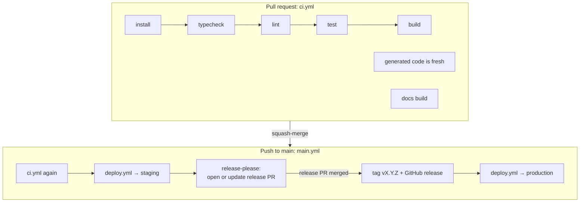

# CI/CD

**GitHub Actions does every deploy. Nobody runs a deploy command by hand.**

## The pipeline



| Workflow | Trigger | What it does |
|---|---|---|
| [`ci.yml`](https://github.com/alilibx/manzilo-workflow/blob/main/templates/.github/workflows/ci.yml) | Every PR, and called by `main.yml` | The checks from `AGENTS.md`, one job per package; generated code is fresh; docs build |
| [`main.yml`](https://github.com/alilibx/manzilo-workflow/blob/main/templates/.github/workflows/main.yml) | Push to `main` | CI → staging deploy → release-please → production deploy if a release was cut |
| [`deploy.yml`](https://github.com/alilibx/manzilo-workflow/blob/main/templates/.github/workflows/deploy.yml) | Called by `main.yml`, or run by hand for a rollback | Deploy, migrate, verify the live revision. Production accepts release tags only. |

Release-please runs **after** staging succeeds, so production only gets code that reached staging first.

## Rules each workflow follows

Each rule here was learned from an incident.

- **Never cancel a deploy in flight.** Set `concurrency` with `cancel-in-progress: false` on the deploy *job*. A cancelled deploy sends no failure alert, and staging sat stale for weeks before anyone noticed.
- **Give every long step its own `timeout-minutes`.** A job-level timeout *cancels* the job, and `if: failure()` alerts may never run.
- **Production deploys release tags only.** The deploy refuses anything that isn't `vX.Y.Z`, and checks out `refs/tags/<tag>` so a branch with the same name can't stand in.
- **Untrusted values go through `env:`.** Never write PR titles, branch names or inputs as `${{ }}` inside `run:`. Use `persist-credentials: false` when no git push follows.
- **Least privilege.** `permissions: contents: read` at the top. Only the release job gets `contents: write` and `pull-requests: write`.
- **Secrets only where they're needed.** Pass them to the deploy step, never to `install` (dependency install scripts run arbitrary code).
- **Pin what you run.** Pin the runtime version (`bun-version-file: package.json`), the CLIs (`vercel@<version>`, not `@latest`), and third-party actions by commit SHA.
- **Typecheck separately when the test runner strips types.** `bun test` and most bundlers don't type-check. A type error once surfaced only as a failed staging deploy.
- **Committed generated code must match a fresh run.** CI regenerates it and fails on any diff:
  ```yaml
  - run: bun run codegen
  - run: git add -A && git diff --cached --exit-code
  ```

## Verify what is live

A green deploy step has shipped a blank page twice: once because the bundle held two copies of React, once because a stale build cache produced circular chunks. "The deploy succeeded" is not proof.

1. **The service reports its revision.** The health endpoint returns the commit it runs: `{"status":"ok","revision":"<sha>"}`. The deploy step writes the SHA in.
2. **The deploy waits for it.** The last step polls the health endpoint until it reports the commit just deployed, and fails otherwise.
3. **A browser smoke test** loads the main pages in headless Chromium after each staging and production deploy, and every morning, and fails on a blank page or console errors.

## Alerts

Send deploy results to a phone, with a priority ladder:

| Event | Priority |
|---|---|
| Staging deployed | low (a heartbeat: silence becomes a signal) |
| Staging failed | high |
| Production deployed | default |
| Production failed | urgent (gets through Do Not Disturb) |

PR CI failures don't page anyone; the author already sees them. Test the pager by hand, on the phone: a typo in the alert topic looks the same as a pager that works.

## Optional blocking checks

Cheap checks that turn "remember to" into "can't forget to":

- **Wording.** Fail on banned product terms in UI strings and docs (old names, words the product no longer uses), with a per-line escape comment.
- **Time zones.** Run the date tests under a far-west and a far-east `TZ`, so "today" bugs show up in CI rather than in production.
- **Changelog.** For hand-written changelogs, fail a PR that changes shipped source without touching `CHANGELOG.md`. See [Releases](/delivery/releases#libraries).
