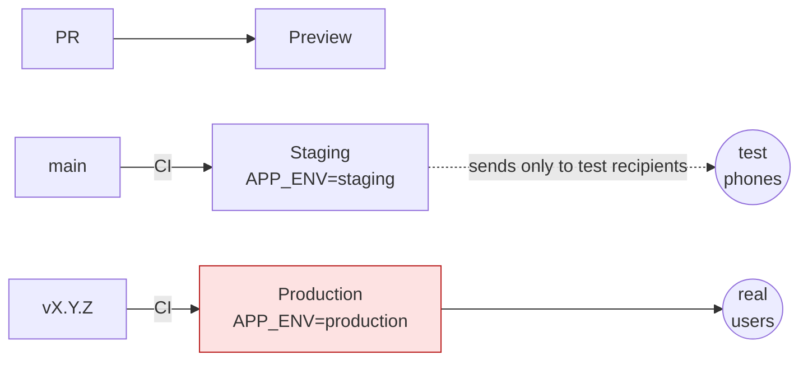

# Environments and side effects

## The tiers

Each tier ties a frontend, a backend deployment, an auth instance and a set of secrets together. They are promoted as a set, never one at a time.

| | Local | Preview (per PR) | Staging | Production |
|---|---|---|---|---|
| Deployed by | You | The PR | Merge to `main` | Release tag `vX.Y.Z` |
| Backend | Your own dev deployment | Shared or per-PR | Staging deployment | Production deployment |
| `APP_ENV` | `development` | `preview` | `staging` | `production` |
| Outbound sends | Suppressed | Suppressed | Test recipients only | Live |
| Data | Disposable | Disposable | Persistent test data | Real |



::: warning Per-PR backends
Isolated per-PR backends are often the last piece built. Until you have one, previews share a backend, and "test this one change on the preview" is only partly true. Say so on this page in your project.
:::

Practical rules:

- **Production is reached only through a tag.** On hosts that deploy from git (Vercel, Netlify), set the production branch to one that doesn't exist on the remote, so no push ever deploys production. CI deploys production from the tag.
- **Show the environment on screen.** A `STAGING` ribbon, driven by the env var, means nobody mistakes a staging tab for production.
- **Env vars live with the deployment** (host settings, backend env, GitHub environments). `.env.example` documents the shape. Nothing sensitive is committed.
- **Hand-made infrastructure is written down.** If storage, CORS or DNS were set by hand, record the exact commands and a check, so the next environment can copy them.

## Side effects never reach real people from non-production

This is the rule with the highest stakes: **staging must never message a real customer, charge a real card, or file a real government form.**

### 1. A validated `APP_ENV` that fails safe

```ts
export type AppEnv = 'production' | 'staging' | 'preview' | 'development'

export function normalizeAppEnv(value: string | undefined): AppEnv {
  if (value === 'production' || value === 'staging' || value === 'preview' || value === 'development') {
    return value
  }
  // Unset or unknown is treated as non-production. An unconfigured deployment
  // suppresses sends instead of messaging real people. The cost: production
  // MUST set APP_ENV=production, or its sends stay off, which is visible and easy to fix.
  if (value !== undefined) console.warn(`Unrecognized APP_ENV="${value}"; treating as non-production`)
  return 'development'
}

export const APP_ENV = normalizeAppEnv(process.env.APP_ENV)

/** The default gate for any new outbound side effect. */
export const sideEffectsLive = APP_ENV === 'production'
```

**Any new outbound side effect** (email, SMS, push, webhook, payment, government filing) with no reason to run outside production **must gate on `sideEffectsLive`.** Outside production it logs what it would have sent and skips the send.

### 2. Per-integration gates for integrations staging must exercise

Some integrations have to work in staging, so QA can test them. Those get their own gate and an allow-list:

```ts
export function sendDecision(to: string): 'live' | 'suppress' {
  if (process.env.SMS_SEND_MODE !== 'live') return 'suppress'          // unset → suppress
  if (APP_ENV === 'production') return 'live'
  const allowed = (process.env.SMS_TEST_RECIPIENTS ?? '').split(',')  // unset → nobody
  return allowed.includes('*') || allowed.includes(to) ? 'live' : 'suppress'
}
```

- **One chokepoint.** Every send goes through one function, and a test fails if anything else calls the provider's endpoint.
- **A suppressed send returns a fake success** (id `suppressed-staging`), so the rest of the flow runs unchanged. Admin views show it as *Suppressed*.
- **Set the recipient list before the mode.** `*` (anybody) is only for fully synthetic data.

### 3. Sandboxes by URL or account

When a vendor has a sandbox, point non-production at it by URL (a payment sandbox, a government QA endpoint) or use a separate account (storage, email domain).

### 4. Destructive operations fail *closed*

A gate that *suppresses* a send defaults to "non-production" when the environment is unset. A gate that *deletes data* must not use that default. A data wipe reads the **raw** value, and runs only when it is exactly a known non-production name:

```ts
const NON_PRODUCTION = ['development', 'staging', 'preview'] as const

export function wipeRefusal(raw = process.env.APP_ENV): string | null {
  if (raw === 'production') return 'Wipes are disabled in production.'
  if ((NON_PRODUCTION as readonly string[]).includes(raw ?? '')) return null
  return `Wipes are disabled until APP_ENV is exactly one of ${NON_PRODUCTION.join(', ')} (it is ${raw ?? 'unset'}).`
}
```

### 5. Inbound webhooks route explicitly

When one vendor callback URL serves several environments or developers, route each message by a rule (receiving number, sender). **A message no rule claims is dropped.** There's no default destination, because a guess is how real traffic lands in the wrong database.

### 6. The reviewer enforces it too

Restate the gating rule in the review bot's `path_instructions` for the backend, and in the [PR template](https://github.com/alilibx/manzilo-workflow/blob/main/templates/.github/pull_request_template.md).
