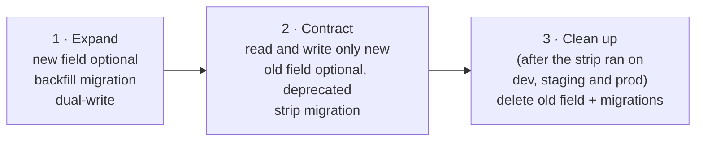

# Schema migrations

Adding a table, an optional field or an index needs no migration. A **breaking** change to stored data (a field becomes required, changes type, is renamed or removed) is **never one deploy. It is always three**: expand, contract, clean up. Staging and production hold real rows the whole time, so skipping a step doesn't fail in CI. It fails as a rejected deploy or a corrupt read against live data, found by whoever deploys next.

1. **Expand.** Add the new shape as optional. Write a migration that backfills it from the old fields. **Every writer of the old fields also writes the new ones (dual-write)**, through the same pure mapping function the migration uses, or rows created between deploys will break step 2.
2. **Contract.** Ship code that reads and writes only the new fields. The old fields stay in the schema as optional, with a comment marking them deprecated and saying why. Add a strip migration that clears them.
3. **Clean up.** Once the strip has completed on **every** environment, delete the old fields and both migration files. This is the only step that removes anything.

Never collapse these steps.

## How migrations run

There are two kinds of step, and they run at different times. Both are in [`deploy.yml`](https://github.com/alilibx/agentic-development-workflow/blob/main/templates/.github/workflows/deploy.yml).

| Step | When | Why then |
|---|---|---|
| **Schema migrations** (SQL: Prisma, Drizzle, Alembic…) | **Before** the code deploy | The new code queries the new columns as soon as it starts. Schema migrations are expand-only, so the code that is live right now keeps working against them. |
| **Data migrations and backfills** | **After** the code deploy, blocking | They fill the new shape. Idempotent, so a run with nothing pending does nothing, and a backfill lands the moment its code does, with no manual step. |

Backends where the schema push *is* the deploy (Convex, for example) have no separate schema step: the deploy applies the schema, and backfills run after it.

- **Back up before migrating production.** Take a dump (or check the point-in-time recovery window) right before the schema step, in the same job. A failed migration then costs a restore, not the data.
- Migrations live in **one ordered list**. Append to it; never reorder it.
- The run prints each migration's status and the number of rows processed, so the CI log is the proof.
- For SQL databases, every schema change is a committed migration file from your ORM. CI applies them; nobody runs them against staging or production by hand.

## Reference data is seeded, not migrated

Catalogues, plans, lookup tables and other platform data that every environment needs are written by an **idempotent seed** that runs after the migrations on every deploy (the `Seed reference data` step). Once seeded, it's a no-op; a new entry in the code reaches every environment on its next deploy. Test it: a second run changes nothing.

## Checklist

- [ ] Is it actually breaking? A new table, optional field or index needs no migration.
- [ ] **Expand:** optional field, backfill migration added to the list, dual-write from every writer through a shared mapping function.
- [ ] Tests: run the migration twice, and the second run changes nothing. Test the mapping and the rows with nothing to backfill from.
- [ ] Dry-run against a real deployment's data before trusting it.
- [ ] Merge; CI runs it. Check the log.
- [ ] **Contract:** new fields only; old fields marked deprecated; strip migration added.
- [ ] After the strip has completed on dev, staging **and** production: **clean up**.
- [ ] Log the migration in `docs/engineering/migrations.md` with its issue.

A one-off script instead of a migration is fine only for small tables that will never need batching.
