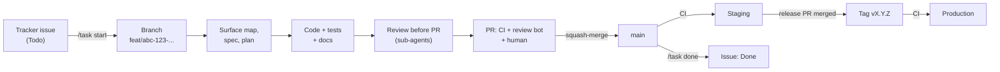

# What this is

This is the Agentic Development Workflow: a process for building software with a coding agent doing much of the work. It started as the process behind [Manzilo](https://manzilo.com), a property management platform, and was later carried into several other projects. It is written so that another project can adopt it. It covers how work is picked, how code reaches `main`, how `main` reaches production, and how Claude Code fits into each step.

It was written for a team of two developers, one QA engineer, and a lot of agent work. Nothing in it breaks with ten developers.

## The loop

Every change, however small, goes around the same loop.

1. **Pick and claim.** `/task` recommends the next issue from the tracker. `/task start ABC-123` assigns it, moves it to In Progress, and creates the branch. See [The task loop](/workflow/task-loop).
2. **Map before you plan.** List every app, backend module, job, generated file and doc page the change touches. See [Surface mapping](/workflow/surface-mapping).
3. **Spec and plan** anything larger than a fix. See [Specs and plans](/workflow/specs-and-plans).
4. **Build it properly.** Load the skill for the stack, read the docs for the pinned version, fix root causes, and write tests. See [Engineering standards](/guide/standards).
5. **Review before the PR.** Sub-agents review the work while it is cheap to change. See [Sub-agents](/claude/agents).
6. **Open the PR.** CI and the review bot run. A human reviews it. It is squash-merged. See [Pull requests and review](/workflow/pull-requests).
7. **Ship.** The merge deploys staging. Merging the release PR tags a version and deploys production. See [CI/CD](/delivery/ci-cd) and [Releases](/delivery/releases).
8. **Close.** `/task done` posts what shipped on the issue, sets it to Done, and offers the next pick.

## What makes it work

Most teams already *say* "don't push to main" and "keep the docs current". Here, each rule that matters is either enforced by a machine or built into a tool the agent runs:

| Rule | Enforced by |
|---|---|
| No commits to `main` | A git `pre-commit` hook, switched on by `bun install` |
| Every change has an issue, and the issue's status is true | The `/task` skill and a PR-lifecycle hook |
| Code is reviewed | CI, a review bot, a human, and sub-agent reviews before the PR |
| Only tested code reaches production | Staging deploys first; production takes only release tags |
| Nothing reaches real people from staging | Side-effect gates that fail safe |
| Docs match the code | Docs updated in the same PR, checked by `docs-auditor` |
| The agent follows all of this | `CLAUDE.md` / `AGENTS.md`, loaded every session |

::: tip Honest about gaps
Where a page describes something only some setups have, such as server-side branch protection or a per-PR backend, it says so in a callout. A manual that only describes the target state makes people test the wrong thing.
:::

## How to read this manual

- **Adopting it?** Start with [Adopt it in a project](/guide/adopt). It copies the templates and lists what to fill in.
- **New to the team?** Read the Workflow section in order, then [Claude Code](/claude/).
- **Looking for a file?** Go to [Templates](/templates/).
