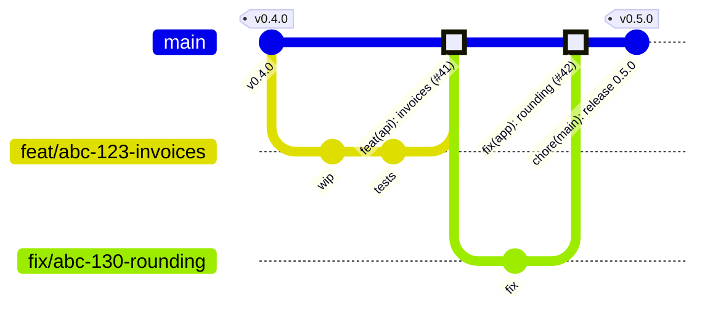

# Branching and commits

## Trunk-based

- `main` is the only long-lived branch, and it is always releasable. There is no `develop` and there are no release branches. Releases are tags.
- **No direct commits to `main`, ever.** That includes "tiny" doc fixes.
- Every change is a short-lived branch (hours to days) holding one logical change. A branch that grows into three unrelated areas gets split.



## Branch names

`<prefix>/<key>-<id>-<short-slug>`, for example `feat/abc-136-contractor-assignment`.

| Prefix | For |
|---|---|
| `feat/` | New behaviour |
| `fix/` | A bug fix |
| `refactor/` | No behaviour change |
| `chore/` | Tooling, dependencies, config |
| `docs/` | Docs only |
| `hotfix/` | An urgent production fix ([Releases](/delivery/releases#hotfix)) |

The lower-case issue key links the branch and its PR to the issue in Linear.

## Conventional Commits

Commit messages and PR titles follow [Conventional Commits](https://www.conventionalcommits.org), with the part of the repo as the scope:

```
feat(app): show the invoice total on the order screen
fix(api): round fils half-up when splitting a payment
chore(ci): pin release-please to a commit SHA
feat(api)!: rename `amount` to `amountFils`
```

PRs are **squash-merged**, so the PR title becomes the one commit on `main`. [release-please](/delivery/releases) reads those titles to choose the next version and write the changelog: `feat` bumps the minor version, `fix` bumps the patch, and `!` or a `BREAKING CHANGE:` footer bumps the major version (the minor version, before 1.0).

::: tip Merge commits instead?
If your repo merges with merge commits, every commit in the PR lands on `main` and counts toward the changelog, so every commit message must follow the format. Pick one merge style and write it down.
:::

## The pre-commit hook

A git hook, not a promise, keeps commits off `main`. [`.githooks/pre-commit`](https://github.com/alilibx/agentic-development-workflow/blob/main/templates/.githooks/pre-commit) refuses any commit while the current branch is `main`:

```sh
branch=$(git branch --show-current 2>/dev/null)
git rev-parse --verify --quiet HEAD >/dev/null || exit 0   # root commit of a new repo
if [ "$branch" = "main" ]; then
  echo "Branching policy: no direct commits to main, ever, including doc fixes." >&2
  exit 1
fi
```

`.githooks/pre-merge-commit` runs the same check for `git merge`, which doesn't run `pre-commit`. `.githooks/pre-commit.test.sh` tests both against scratch repos: a commit on `main` is refused, a feature branch, detached HEAD and a worktree are allowed, and a `merge --no-ff` into `main` is refused.

**Activation.** The package manager's install script runs `git config core.hooksPath .githooks`. Worktrees share the repo's config, so one install covers all of them. See [Adopt it](/guide/adopt#_2-switch-the-hook-on-for-everyone).

**If it fires, create a branch.** Don't fight it.

### Why a git hook and not an agent hook

We first blocked this with a Claude Code `PreToolUse` hook that read the shell command and guessed the branch from `cd` and `-C`. That can always be bypassed: `pushd`, `GIT_DIR=`, aliases, subshells, or a human in a terminal. Git always knows which repo and branch a commit lands in, so the check belongs in git.

### What the hook doesn't cover

- A clean `cherry-pick`, `revert` or `rebase` creates commits without running either hook.
- `git commit --no-verify` skips it.
- A push from a clone that never ran the install skips it.

Server-side branch protection closes all three: require a PR, one approval, the CI checks, and linear history, and block force-pushes. Turn it on as soon as your GitHub plan allows. Until then, admins who bypass it in an emergency should say so in the PR (see [Break-glass](/delivery/releases#break-glass)).
