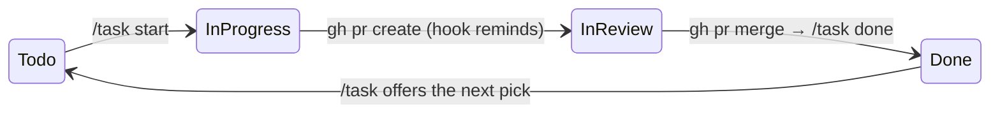

# The task loop

**Everything goes through the tracker.** Every change maps to an issue. If no issue fits, ask the person who owns the board where it belongs, before starting. Agents never start work or create issues silently.

We use [Linear](https://linear.app). The skill assumes Linear's hierarchy (initiative → project → issue), and maps onto other trackers easily (epic or milestone → issue).

The loop runs through one skill, `/task`, in three modes. The skill ([template](https://github.com/alilibx/manzilo-workflow/blob/main/templates/.claude/skills/task/SKILL.md)) is the executable source of truth. This page is the human contract behind it.



## `/task`: what should I work on?

Read-only. It never writes to the tracker.

1. **Work in progress comes first.** If you have an issue In Progress, the answer is "resume it". No new pick is offered unless you insist. More than two issues in flight gets called out. Issues In Review get a "chase the review" nudge, and then the pick continues.
2. **Only ready work is pickable.** An issue qualifies only if all of these hold:

   | Guard | Rule |
   |---|---|
   | Initiative | status **Active** |
   | Project | status **started** or **planned** (started ranks first) |
   | Issue state | **Todo** (Backlog is not ready) |
   | Blockers | no open "blocked by" relation |
   | Owner | assigned to you, or unassigned; never someone else |
   | Freshness | updated in the last 90 days |
   | Archive | not archived |

3. **The cascade orders it.** Initiative priority and target date, then project status, priority and target date, then issue priority, due date and age. At equal rank, your own issues come first.
4. **It shows its reasoning.** You get the top pick with the path spelled out ("X is the top Active initiative, Y is its highest-ranked project, and this is its highest-priority unblocked Todo"), plus up to two runners-up.
5. **It flags, never fixes.** A footnote lists stale issues and Urgent or High issues with no project, for the board owner. If nothing qualifies, it says so and sends you to the board owner. It never invents work.

## `/task start ABC-123`: claim it

1. Re-read the issue, in case someone took it in the meantime.
2. Assign you, set **In Progress**, and add it to the current cycle.
3. Branch from a fresh `main`: `feat/abc-123-short-slug`. The lower-case key in the branch name makes Linear link the PR automatically.
4. Brief you **before any code**: the description, acceptance criteria, linked docs and PRs, and the QA test cases that cover the area.

An explicit `/task start` skips the cascade, for urgent interruptions. The picker is the default, not a cage.

## Opening the PR: In Review

When `gh pr create` runs, a [hook](/claude/hooks) reminds the agent to move the issue to **In Review**.

## `/task done`: close it out

After the merge (a hook reminds the agent after `gh pr merge`; after a merge in the GitHub UI, run it by hand):

1. Post the completion comment:

   ```
   ✅ Shipped: <one-line summary>
   PR: <link> (merged)
   Evidence: <typecheck, build and tests run; QA notes or screenshots>
   Docs: <pages updated | "no docs affected">
   Follow-ups: <proposed to the board owner | "none">
   ```

2. Set the issue to **Done**.
3. Propose follow-ups in the comment and in chat. **Never create them.** The board owner decides.
4. Run `/task` again and offer the next pick.

## What the agent may write, and what it never does

| Allowed | Never |
|---|---|
| Assign **you** on claim | Create issues |
| Todo → In Progress → In Review → Done on your issue | Reassign someone else's issue |
| Add your claimed issue to the current cycle | Change priorities |
| Post the completion comment | Edit projects, initiatives or cycles |

## The hygiene contract

The cascade is only as truthful as the board. The board owner keeps these groomed: initiative statuses, project-to-initiative links, project statuses, priorities and blocked-by relations. The skill flags gaps; it doesn't fix them.

## Design choices

- **A priority cascade, not the cycle.** Cycles are ignored for picking. Claimed issues are still added to the current cycle, so the burndown stays honest.
- **Scope guards instead of a backlog cleanup.** Stale and unready issues are filtered out, not deleted.
- **Claim only on confirmation.** The skill recommends; the developer decides.
- **No answers from memory.** If the tracker can't be reached, the skill says so and stops.

## People who don't use the tracker

Some people on the team, such as QA or commercial, may not use Linear, so an @mention there never reaches them. Agree where their work lives (a shared workbook, for example), and add a line to `AGENTS.md` saying who updates it after fixes ship.
