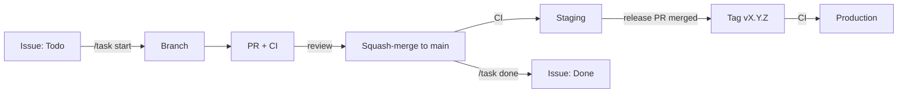

# Engineering

How a change goes from an issue to production. Read the matching page **before** any branch, PR, deploy or release action.

## Guiding principles

- **`main` is always releasable.** If it's red, fixing it comes first.
- **Every change is reviewed,** by the review bot and by a human. No direct commits to `main`.
- **Production is reached only through a release tag,** and only after the code ran on staging.
- **Side effects are off outside production.** No non-production environment messages a real person or moves real money.
